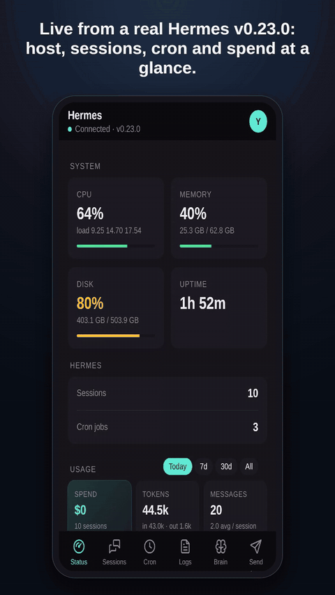
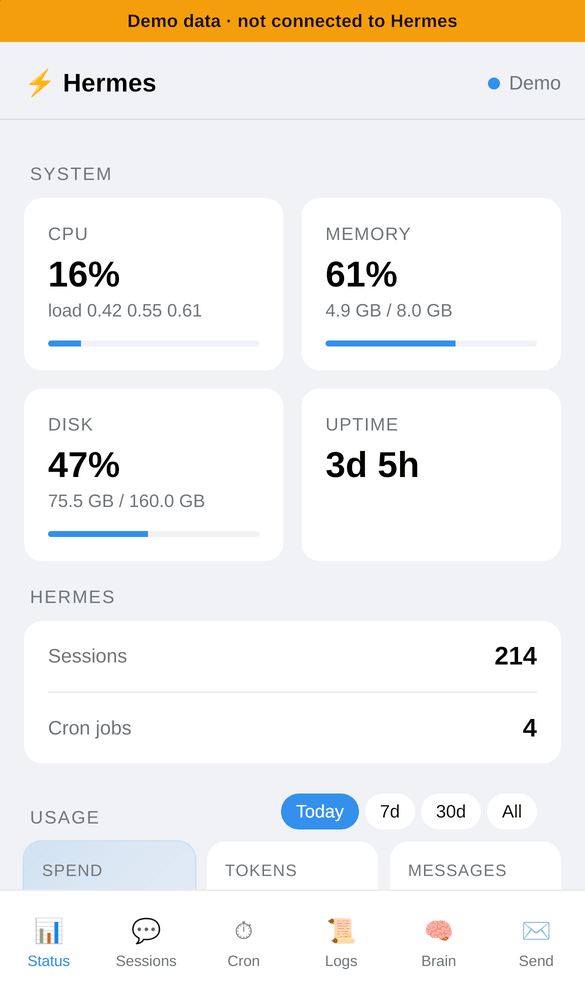
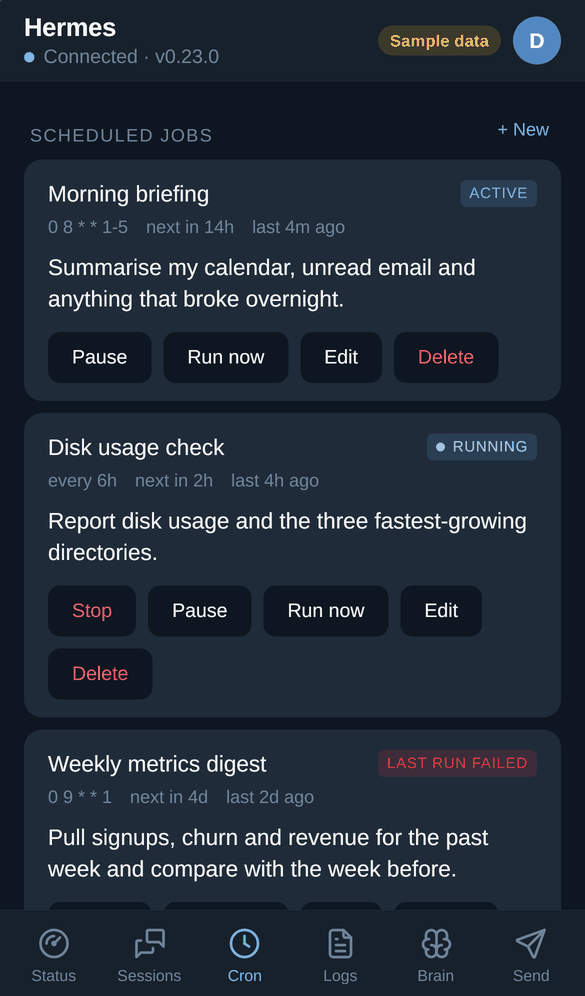
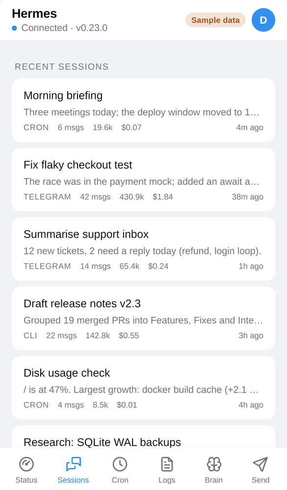
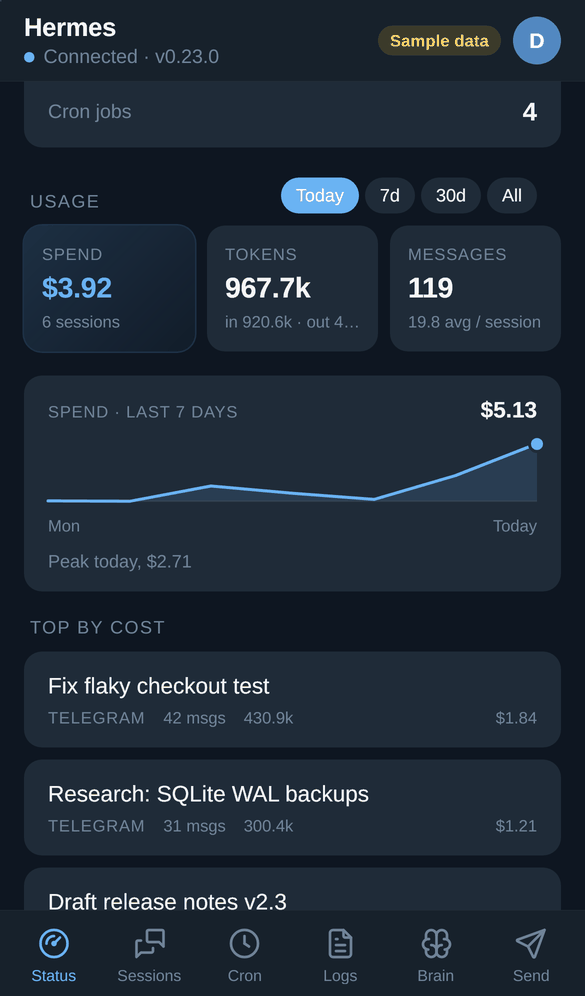
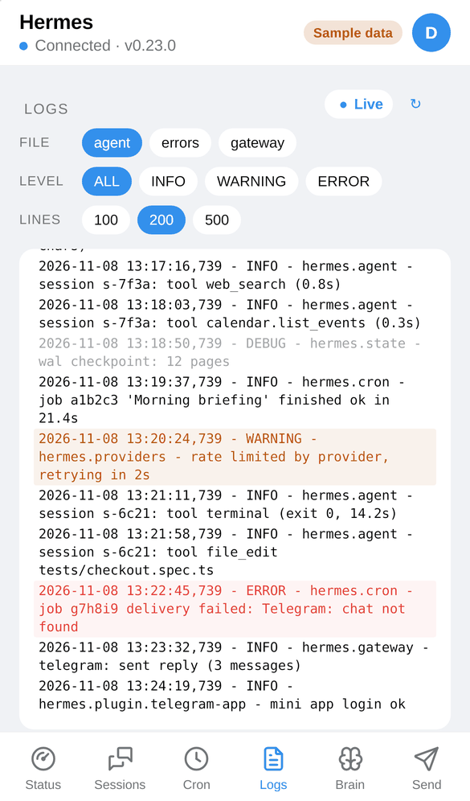
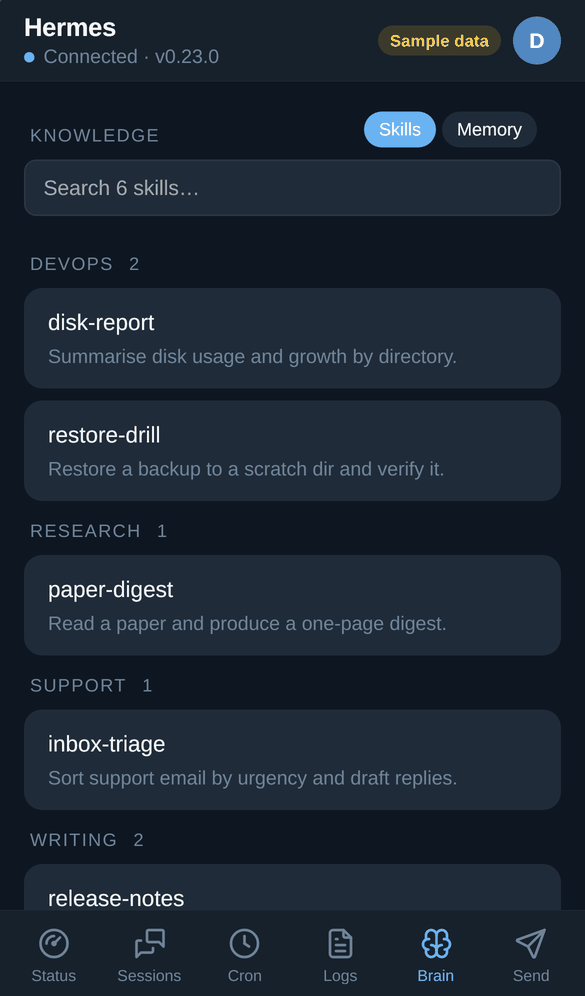

<p align="center"></p>

<h1 align="center">Hermes Telegram Mini App</h1>

<p align="center"><a href="https://github.com/aimanmalib/hermes-telegram-miniapp/actions/workflows/ci.yml"></a> <a href="https://github.com/aimanmalib/hermes-telegram-miniapp/releases/latest"></a> <a href="https://github.com/aimanmalib/hermes-telegram-miniapp/blob/main/LICENSE"></a></p>

<p align="center"><b>A phone control panel for Hermes Agent, inside Telegram.</b> · <i>Panel kawalan telefon untuk Hermes Agent, dalam Telegram.</i><br>
<a href="#setup">setup</a> · <a href="#demo-mode">demo mode</a> · <a href="https://github.com/aimanmalib/hermes-telegram-miniapp/blob/main/SECURITY-REVIEW.md">security review</a> · <a href="https://github.com/aimanmalib/hermes-telegram-miniapp/blob/main/CHANGELOG.md">changelog</a> · Built in Malaysia by <a href="https://aimanmalib.com">Aiman Malib</a></p>

Run, stop and edit your [Hermes Agent](https://github.com/NousResearch/hermes-agent) cron jobs, check spend, read sessions and logs, and get a Telegram alert when a run fails, all from your bot's menu button.

No VPN, password or new account: login checks the `initData` Telegram signs for the Mini App against an admin list that refuses everyone until you fill it in, and only `/api/plugins/telegram-app/*` needs to face the internet. It ships as a Hermes **dashboard plugin** plus a small React app; nothing in Hermes is patched. CI installs a real Hermes v0.23.0 and drives the plugin through its dashboard on every change, the [security review](SECURITY-REVIEW.md) is public, and there are 10 tagged releases.

### Why a Mini App, not the dashboard on your phone

- **Nothing new to expose.** The Hermes dashboard is meant for loopback; publishing it means a VPN or a login proxy. This panel publishes one plugin path, and only for Telegram ids you list.
- **Telegram is the login.** Telegram signs who you are each time the app opens; there is no password to set, leak or rotate.
- **Made for the phone you carry.** It follows Telegram's light or dark theme and uses its haptics, and alerts land in the chat you already have open.

<p align="center"></p>

Built for the Hermes Agent Plugin Hackathon by Nous Research, November 2026. [Watch the demo video on X](https://x.com/aimanmalib_/status/2120142003367526476).

[Bahasa Melayu ↓](#bahasa-melayu)

<table>
  <tr>
    <td></td>
    <td></td>
    <td></td>
  </tr>
  <tr>
    <td></td>
    <td></td>
    <td></td>
  </tr>
</table>

<sub>Screenshots use the built-in <a href="#demo-mode">demo mode</a> (sample data, iPhone 13 in WebKit, Telegram-style day and night palettes). More in <a href="https://github.com/aimanmalib/hermes-telegram-miniapp/tree/main/docs/screenshots/">docs/screenshots</a>, including the <a href="https://github.com/aimanmalib/hermes-telegram-miniapp/blob/main/docs/screenshots/cron-ms-light.png">Malay UI</a>.</sub>

## Features

- **Status**: CPU, memory, disk, load and uptime; session and cron counts; token and cost totals for today, 7 days, 30 days or all time, with the most expensive sessions.
- **Push alerts** (configured from the Status tab): a Telegram DM to the first admin when a cron run fails, when `errors.log` gets new errors (throttled, off by default) or when the day's estimated spend crosses a threshold.
- **Sessions**: recent sessions with source, message count, tokens and cost; open one to read its messages.
- **Cron**: create, edit, pause, resume, run now and delete agent cron jobs. Failed last runs are flagged. On Hermes v0.23.0 or later, stop a job that is running and choose per job whether missed runs are caught up ("Run missed jobs").
- **Logs**: tail `agent.log`, `errors.log` or `gateway.log`, filtered by level, with live refresh.
- **Brain**: search installed skills and read `SKILL.md`, read the agent's `MEMORY.md` and `USER.md`.
- **Ask Hermes**: type a question or tap a saved preset. Hermes runs it once as an agent cron job and sends the answer to your Telegram chat, while the tab shows it queued, answering and sent. See [decision 0008](docs/decisions/0008-ask-hermes.md).
- **English and Malay.** The app uses your Telegram language when it is Malay and English otherwise; an EN | BM switch at the bottom of the Status tab overrides it. Adding a language is one JSON file in `web/src/i18n/`.
- Follows your Telegram light or dark theme, uses Telegram haptics.

## How it works

```
┌─────────────────┐  Telegram WebView
│ Telegram phone  │  ┌──────────────────────────┐
│   bot menu  →───┼──┤ React SPA (this repo)    │
└─────────────────┘  │ Telegram.WebApp.initData │
                     └────────────┬─────────────┘
                                  │ POST initData
                                  │ HTTPS via your reverse proxy,
                                  │ which forwards ONLY /api/plugins/telegram-app/*
                                  ▼
       ┌───────────────────────────────────────────────┐
       │ Hermes dashboard (FastAPI, 127.0.0.1:9119)    │
       │  /api/plugins/telegram-app/auth/verify        │
       │    ├─ HMAC-SHA256 with the bot token          │
       │    ├─ fallback: Ed25519, Telegram public key  │
       │    ├─ auth_date freshness window              │
       │    └─ admin list (fails closed)               │
       │  returns the dashboard session token          │
       └───────────────────────────────────────────────┘
```

1. The SPA reads `window.Telegram.WebApp.initData` and posts it to `/auth/verify`.
2. The plugin verifies it (below) and returns the dashboard's session token.
3. The SPA sends that token as `X-Hermes-Session-Token` on every other call. The dashboard's own auth middleware checks it; the plugin does not run a second auth system.

## Security model

This panel controls an AI agent, so the login path is strict. The full review, with each finding and what changed, is in [SECURITY-REVIEW.md](SECURITY-REVIEW.md).

- **Signature.** `initData` is accepted only if its `hash` matches `HMAC-SHA256(key = HMAC-SHA256("WebAppData", bot_token), data_check_string)`, compared in constant time, exactly as in [Telegram's spec](https://core.telegram.org/bots/webapps#validating-data-received-via-the-mini-app). If that fails, the Ed25519 `signature` is checked against Telegram's published production key ([third-party validation](https://core.telegram.org/bots/webapps#validating-data-for-third-party-use)), using the bot id from your token.
- **Freshness.** `auth_date` is required and must be at most **1 hour** old by default (`TELEGRAM_INITDATA_MAX_AGE`, in seconds, clamped to 60 s to 7 days). Values more than 60 s in the future are rejected. Telegram issues new `initData` each time the Mini App opens, so the window only needs to cover one session; if the dashboard restarts after the window, reopen the app.
- **Admin list.** Only numeric Telegram user ids in `TELEGRAM_OWNER_ID` and the plugin's own `admins` setting can log in, receive alerts and be messaged by the send box. Hermes's `TELEGRAM_ALLOWED_USERS` (who may chat with the bot, filled in by the QR setup) is never read: being allowed to chat never grants the panel. With no admin set, every login is refused (HTTP 503) instead of letting anyone in. See [decision 0007](docs/decisions/0007-admin-list-is-plugin-owned.md).
- **Abuse limits.** After 10 failed attempts in 5 minutes from one client address the endpoint answers 429. Every rejection returns the same generic 403. Behind a reverse proxy all clients share the proxy's address, so the limit is effectively global; that suits a single-owner panel.
- **No secrets in logs or the client.** The bot token never leaves the server; `initData` and tokens are not logged; responses carrying the token are `Cache-Control: no-store`.
- **What the token grants.** It is the dashboard's own session token, valid until the dashboard restarts, and it authorises the whole dashboard API, not only this plugin. That is why the reverse proxy should forward **only** `/api/plugins/telegram-app/*` (see setup). The plugin's own write endpoints are narrow: cron create accepts agent jobs only (no `script`, `no_agent` or `workdir`), and the bot only posts to admins.
- **`initData` also passes Hermes's other token routes.** Hermes asks every token provider on every token route, so with `HERMES_DASHBOARD_DRAIN_SECRET` set a valid `initData` also gets past the token gate of `/api/gateway/drain`, which the session token alone cannot. The plugin's principals carry the scope `telegram-app`; once Hermes has per-route scopes ([NousResearch/hermes-agent#146551](https://github.com/NousResearch/hermes-agent/pull/146551)) drain demands its own scope and refuses `initData`, and the plugin's login route demands `telegram-app`. Nothing to configure: the plugin detects the feature. See [decision 0006](docs/decisions/0006-login-through-the-token-seam.md).

## Compatibility

**Tested by running Hermes v0.23.0 in CI.** For each release listed in [`compat/hermes-versions.json`](compat/hermes-versions.json), the `hermes-contract` job installs that Hermes, links the plugin into a temporary Hermes home with synthetic credentials, and calls `/health`, login, status, sessions, cron (including stop and catch-up) and logs through the real dashboard app (`tests/contract/`). The plugin declares `requires_hermes: ">=0.23.0"` and passes `hermes plugins validate`.

What the plugin uses from Hermes:

- Dashboard plugins are discovered at `~/.hermes/plugins/<name>/dashboard/manifest.json`; the `api` file is imported and its `router` mounted at `/api/plugins/<name>/`.
- User plugins' backends load only when the plugin name is in `plugins.enabled` (Hermes security change, see setup).
- The session header is `X-Hermes-Session-Token`; every plugin route needs it except the login route.
- The login route uses Hermes's token-auth seam (v0.23.0+): `plugin/__init__.py` registers a token provider with `ctx.register_dashboard_auth_provider` and marks `POST /auth/verify` as a token route. The Mini App sends its Telegram `initData` as `Authorization: Bearer …`; the provider runs the full check before the route runs. Nothing is added to the dashboard's public paths.
- Data sources the endpoints use: `hermes_state.SessionDB` (`list_sessions_rich`, `session_count`, `get_messages`), `cron.jobs` (`list_jobs`, `create_job`, `update_job`, `remove_job`, `pause_job`, `resume_job`, `trigger_job`, and `cancel_job_run` when present), and `~/.hermes/logs/{agent,errors,gateway}.log`.
- Optional features are detected by probing Hermes, not by version: `GET /api/plugins/telegram-app/health` lists them under `capabilities` (`cron_cancel`, `cron_catch_up`), and the app hides Stop and "Run missed jobs" when they are missing.

Requirements and caveats:

- The dashboard must run in its default **loopback token mode** (bound to `127.0.0.1`). If you set `dashboard.public_url` or bind publicly, Hermes switches to its cookie/OAuth gate and this plugin's token login will not work.
- `plugins.isolation: host` (plugins in a separate process) is not supported; the default `in_process` is.
- The plugin still reads one private Hermes name, `_SESSION_TOKEN` in `hermes_cli.web_server`, to hand the dashboard session token to the phone, plus `hermes_cli.dashboard_auth.token_auth.register_token_route`. A Hermes release that renames them breaks login, which then fails closed. `GET /api/plugins/telegram-app/health` (session token required) reports `"auth_mode": "token-seam"` while login works and `"unavailable"` when it does not. See [decision 0006](docs/decisions/0006-login-through-the-token-seam.md).

## Setup

You need a Hermes install with the dashboard, a bot from [@BotFather](https://t.me/BotFather), your numeric Telegram user id (for example from [@userinfobot](https://t.me/userinfobot)), a domain with HTTPS in front of the server, and Node.js 22 (or 20.19+) to build the app.

### 1. Configure Hermes

`~/.hermes/.env`:

```bash
TELEGRAM_BOT_TOKEN=123456789:AA...
# Mini App admins: one id, or several comma-separated
TELEGRAM_OWNER_ID=1234567890
# Optional: initData freshness window in seconds (default 3600)
# TELEGRAM_INITDATA_MAX_AGE=3600
```

The plugin reads these through Hermes (`agent.secret_scope.get_secret`), never from the file itself. Values saved
through Hermes apply at once; after editing `.env` by hand, restart the dashboard.

`~/.hermes/config.yaml`, so Hermes is allowed to load the plugin's backend:

```yaml
plugins:
  enabled:
    - telegram-app
  # Optional plugin settings (read on every login, no restart needed):
  # entries:
  #   telegram-app:
  #     settings:
  #       admins: [9876543210]    # more admins besides TELEGRAM_OWNER_ID
  #       alerts_enabled: false   # do not start the alerts watcher (read at dashboard start)
```

`TELEGRAM_ALLOWED_USERS` only controls who may chat with the bot; it does not let anyone log in to the Mini App. Upgrading
from 0.5.x with only that variable set: copy your id into `TELEGRAM_OWNER_ID` (or `admins`), or login answers 503.

The Ed25519 fallback uses the `cryptography` package, which current Hermes already depends on. Without it, HMAC verification still works.

### 2. Install

```bash
git clone https://github.com/aimanmalib/hermes-telegram-miniapp.git
cd hermes-telegram-miniapp
./scripts/install.sh
```

The script builds the app into `dist/`, copies it to `WEB_ROOT` (default `/var/www/telegram-app`, set `SUDO=sudo` if needed, or `SKIP_DEPLOY=1`), symlinks `plugin/` to `~/.hermes/plugins/telegram-app`, warns if `plugins.enabled` is missing, restarts `hermes-dashboard` if that systemd unit exists, and checks `/api/dashboard/plugins` and that the login route answers `401` without initData. Plugin routes are mounted at dashboard start, so restart the dashboard yourself if you do not use that unit.

### 3. Reverse proxy (Caddy example)

```caddy
app.example.com {
    # Forward ONLY the plugin's API. The rest of the dashboard API stays off the internet.
    handle /api/plugins/telegram-app/* {
        reverse_proxy 127.0.0.1:9119 {
            # Hermes rejects Host headers that don't match its bind address.
            header_up Host {upstream_hostport}
        }
    }
    handle /api/* {
        respond 404
    }
    handle {
        root * /var/www/telegram-app
        try_files {path} /index.html
        file_server
    }
    encode gzip
    @assets path /assets/*
    header @assets Cache-Control "public, max-age=31536000, immutable"
    header /index.html Cache-Control "no-cache"
    header Content-Security-Policy "default-src 'self'; script-src 'self' https://telegram.org; style-src 'self' 'unsafe-inline'; img-src 'self' data:; connect-src 'self'; frame-ancestors https://web.telegram.org https://*.telegram.org"
}
```

### 4. Bot menu button

```bash
TOKEN=<bot token>; USER_ID=<your id>; URL=https://app.example.com/
curl -sS -X POST "https://api.telegram.org/bot${TOKEN}/setChatMenuButton" \
  -H "Content-Type: application/json" \
  -d "{\"chat_id\": ${USER_ID}, \"menu_button\": {\"type\": \"web_app\", \"text\": \"Hermes\", \"web_app\": {\"url\": \"${URL}\"}}}"
```

### 5. Check it

Tap the menu button in your chat with the bot. The Status tab should show live numbers and the header your first name. The dashboard also gets a small **Telegram Mini App** tab showing whether the backend is up.

## Demo mode

Demo mode renders every tab with built-in sample data and makes no API calls, so the UI can be shown without a Hermes server. A small amber **Sample data** pill stays in the header (its tooltip reads "Sample data · not connected to Hermes").

```bash
cd web
npm ci
npm run build:demo        # writes ../dist-demo/ (never ../dist/)
python3 -m http.server 3392 --bind 127.0.0.1 --directory ../dist-demo
# open http://127.0.0.1:3392/?theme=light  (or ?theme=dark; add &lang=ms for Malay)
```

On the Vite dev server, `npm run dev` and open `/?demo=1`. A normal `npm run build` compiles demo mode out completely; `npm run check:no-demo` (run in CI) fails if any demo code reaches `dist/`. The README screenshots are made with `scripts/screenshots.py` from the demo build.

## Development

```bash
# Plugin (Python 3.11+)
pip install -r requirements-dev.txt
python -m pytest

# Web app (Node 22)
cd web && npm ci
npm run typecheck && npm test && npm run build
npm run dev   # Vite on :5173, proxies /api to 127.0.0.1:9119
```

Outside Telegram the dev server can use a real dashboard: set `localStorage.devSessionToken` to the value of `window.__HERMES_SESSION_TOKEN__` from the dashboard page. Production builds ignore it.

The Python tests include known-answer vectors for the HMAC check, computed independently with `openssl`, plus tampering, staleness, allowlist, malformed-input, Ed25519 and HTTP-level tests. CI runs them on Python 3.11 and 3.12, and typechecks, tests and builds the web app on Node 22.

## API

All under `/api/plugins/telegram-app/`.

| Method | Path | Auth | Purpose |
|---|---|---|---|
| GET | `/health` | session | Liveness, plugin and Hermes versions, login path (`auth_mode`), optional Hermes features (`capabilities`) |
| POST | `/auth/verify` | initData bearer | Verify initData (Hermes token seam, then the route again), return the session token |
| GET | `/status` | session | System gauges, session and cron counts |
| GET | `/usage?window=today\|week\|month\|all` | session | Token and cost totals, top sessions |
| GET | `/sessions?limit=N` | session | Recent sessions |
| GET | `/sessions/{id}/messages` | session | Messages of one session (trimmed for phones) |
| GET, POST | `/cron` | session | List jobs (each with `running`), create an agent job (optional `catch_up`) |
| PATCH, DELETE | `/cron/{id}` | session | Edit (including `catch_up`; `null` = Hermes default) or delete a job |
| POST | `/cron/{id}/pause\|resume\|trigger` | session | Pause, resume, run now |
| POST | `/cron/{id}/cancel` | session | Stop the run in flight; `501` with code `unsupported` on a Hermes without it |
| GET | `/logs?file=&lines=&level=` | session | Tail a Hermes log |
| GET | `/skills`, `/skills/{id}` | session | Skill list and `SKILL.md` text |
| GET | `/memory` | session | `MEMORY.md` and `USER.md` |
| GET, PATCH | `/alerts` | session | Alert settings and watcher state |
| POST | `/alerts/test` | session | Send a test alert |
| POST | `/ask` | session | Ask Hermes: one-shot agent job, answer delivered to an admin's chat; `prompt` (and optional admin `chat_id`) only; 422 `too_long`/`empty`, 409 `busy` |
| POST | `/command` | session | Bot posts text to an admin's DM |

## Troubleshooting

- **"Open this app from the Telegram bot menu button"**: the page was opened outside Telegram, so there is no `initData`.
- **`auth/verify 503`** (`Auth provider 'telegram-app-initdata' unreachable`, and `telegram-app: refusing login` in the dashboard log): `TELEGRAM_BOT_TOKEN` or the admin list (`TELEGRAM_OWNER_ID` or the `admins` setting) is missing. `TELEGRAM_ALLOWED_USERS` does not count: it only controls who may chat with the bot.
- **`auth/verify 403`**: wrong bot token, a user id not on the admin list, or `initData` older than the freshness window. Reopen the Mini App; the dashboard log says which check failed (`initData rejected (stale)` and similar).
- **`auth/verify 429`**: too many failed attempts; wait for the `Retry-After` seconds.
- **`401` on every call / 404 on `/api/plugins/telegram-app/...`**: the plugin is not in `plugins.enabled`, or the dashboard was not restarted after installing. Check `curl -X POST http://127.0.0.1:9119/api/plugins/telegram-app/auth/verify`: `401` means mounted, `404` means not mounted.
- **`400 Invalid Host header`**: the proxy forwards your public hostname; keep `header_up Host {upstream_hostport}`.
- **Login works locally but not through the proxy after enabling `dashboard.public_url`**: that setting turns on Hermes' cookie gate, which this plugin does not support.

## Known limitations

- **Ask needs the Hermes gateway running.** The answer is sent by Hermes's cron ticker, which runs in the gateway; without it the question waits in the Cron tab, where you can delete it.
- **`POST /command` does not reach Hermes.** The endpoint is still there for scripts: the bot posts the text into your DM, but Telegram never delivers a bot's own messages back to it, so the gateway does not see it. Use Ask instead.
- Login depends on private Hermes internals (see [compatibility](#compatibility)).
- One dashboard process, one profile: multi-profile hosting and `plugins.isolation: host` are untested.

## How this was built

hermes-telegram-miniapp was built with AI coding assistance (Claude Code) under the direction of its author, Muhammad Aiman.

The evidence that it works is meant to be checkable:

- The test suite, run with `python -m pytest` and `cd web && npm test`.
- CI on Python 3.11 and 3.12, and Node 22 for every pull request.
- Contract tests in CI that install real Hermes v0.23.0 and call the plugin through the Hermes dashboard app.
- 9 tagged releases, with notes in [CHANGELOG.md](CHANGELOG.md).

## Bahasa Melayu

Hermes Telegram Mini App ialah panel kawalan telefon untuk [Hermes Agent](https://github.com/NousResearch/hermes-agent) yang dibuka
di dalam Telegram melalui butang menu bot anda. Ia dihantar sebagai **plugin dashboard** Hermes (laluan backend di bawah
`/api/plugins/telegram-app/`) berserta aplikasi React kecil. Repo Hermes tidak ditampal atau ditindih.

**Ciri utama:**
- **Status:** CPU, memori, cakera, beban dan masa hidup pelayan; bilangan sesi dan cron; jumlah token dan kos untuk hari ini, 7 hari,
  30 hari atau semua, berserta sesi paling mahal.
- **Amaran tolak:** DM Telegram bila larian cron gagal, bila `errors.log` ada ralat baharu (dihadkan, mati secara lalai) atau bila
  anggaran belanja hari itu melepasi had.
- **Sesi, Cron, Log, Otak:** baca sesi dan mesejnya; cipta, sunting, jeda, sambung, jalankan sekarang dan padam kerja cron ejen
  (henti larian dan pilihan "Run missed jobs" pada Hermes v0.23.0 ke atas); ekor `agent.log`, `errors.log` dan `gateway.log`;
  cari kemahiran dan baca `SKILL.md`, `MEMORY.md` serta `USER.md`.
- **Tanya Hermes:** taip soalan; Hermes menjalankannya sekali sebagai kerja cron dan menghantar jawapan ke sembang Telegram anda.
- **Bahasa Inggeris dan Melayu**, ikut bahasa Telegram anda, dengan suis EN | BM. Tema cerah atau gelap ikut Telegram.

**Keselamatan.** Log masuk menyemak tandatangan HMAC-SHA256 `initData` dengan token bot (sandaran Ed25519 dengan kunci awam
Telegram), had umur `auth_date` (lalai 1 jam) dan senarai admin milik plugin yang gagal-tertutup: hanya `TELEGRAM_OWNER_ID` dan tetapan `admins` plugin boleh log masuk;
tanpanya semua log masuk ditolak. `TELEGRAM_ALLOWED_USERS` (siapa boleh berbual dengan bot) tidak pernah memberi akses panel. Proksi songsang patut menghantar **hanya** `/api/plugins/telegram-app/*`, kerana
token sesi yang dipulangkan membuka seluruh API dashboard. Butiran penuh dalam [Security model](#security-model) dan
[SECURITY-REVIEW.md](https://github.com/aimanmalib/hermes-telegram-miniapp/blob/main/SECURITY-REVIEW.md).

**Pasang.** Perlu Hermes dengan dashboard (v0.23.0 ke atas, mod token loopback), bot dari @BotFather, ID pengguna Telegram anda,
domain dengan HTTPS dan Node.js 22 (atau 20.19+).

1. Tetapkan `TELEGRAM_BOT_TOKEN` dan `TELEGRAM_OWNER_ID` dalam `~/.hermes/.env`, dan tambah `telegram-app` di bawah
   `plugins.enabled` dalam `~/.hermes/config.yaml`.
2. Klon repo ini dan jalankan `./scripts/install.sh` (bina aplikasi, salin ke `WEB_ROOT`, paut `plugin/` ke
   `~/.hermes/plugins/telegram-app`).
3. Sediakan proksi songsang (contoh Caddy di [Setup](#setup)) dan tetapkan butang menu bot dengan `setChatMenuButton`.
4. Tekan butang menu dalam sembang dengan bot; tab Status patut memaparkan nombor semasa.

[Mod demo](#demo-mode) memaparkan setiap tab dengan data contoh tanpa pelayan Hermes. Had yang diketahui: Tanya Hermes memerlukan
gateway Hermes berjalan, dan log masuk bergantung pada nama dalaman Hermes (lihat [Known limitations](#known-limitations)).

## Licence

MIT, see [LICENSE](LICENSE). Made by [Aiman Malib](https://aimanmalib.com) in Malaysia. Security issues: see [SECURITY.md](SECURITY.md).

Inspired by [clawvader-tech/hermes-telegram-miniapp](https://github.com/clawvader-tech/hermes-telegram-miniapp), rebuilt as a plugin instead of an overlay on the Hermes web server.

## Work with Sasa Teguh

[](https://sasateguh.com/book)

I built this project. I run [Sasa Teguh](https://sasateguh.com), a studio in Malaysia that builds websites found on Google and in AI answers, and sets up systems like this one for businesses.

[Book a call](https://sasateguh.com/book) · hello@sasateguh.com · [More from Sasa Teguh](https://github.com/sasateguh)
