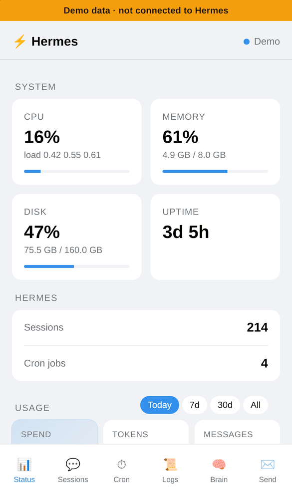
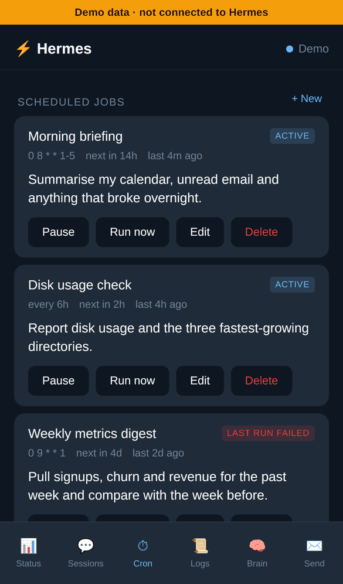
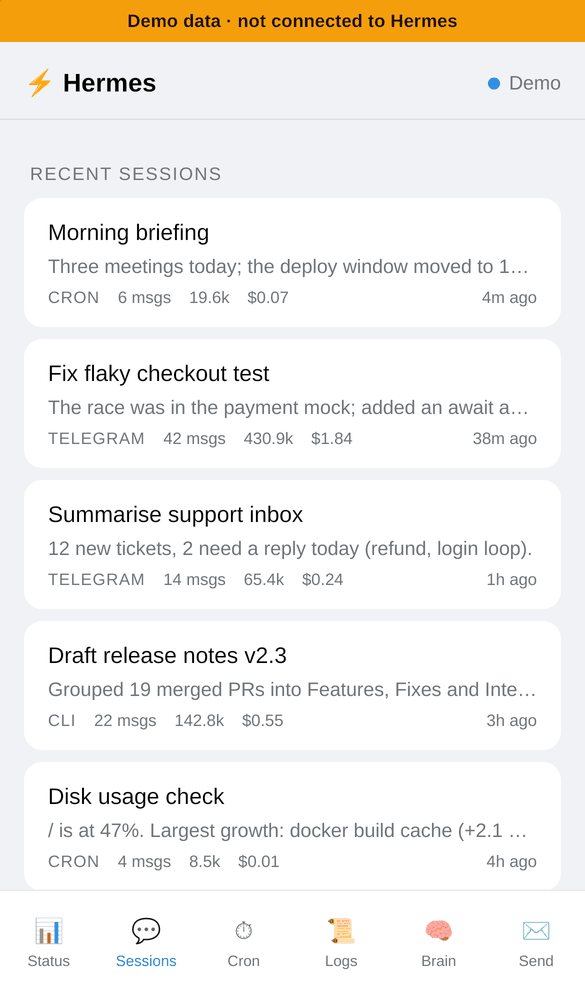
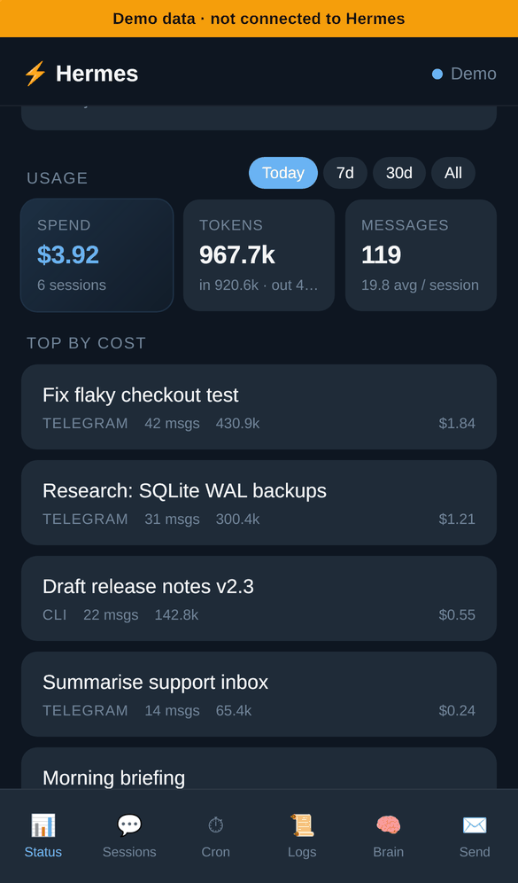
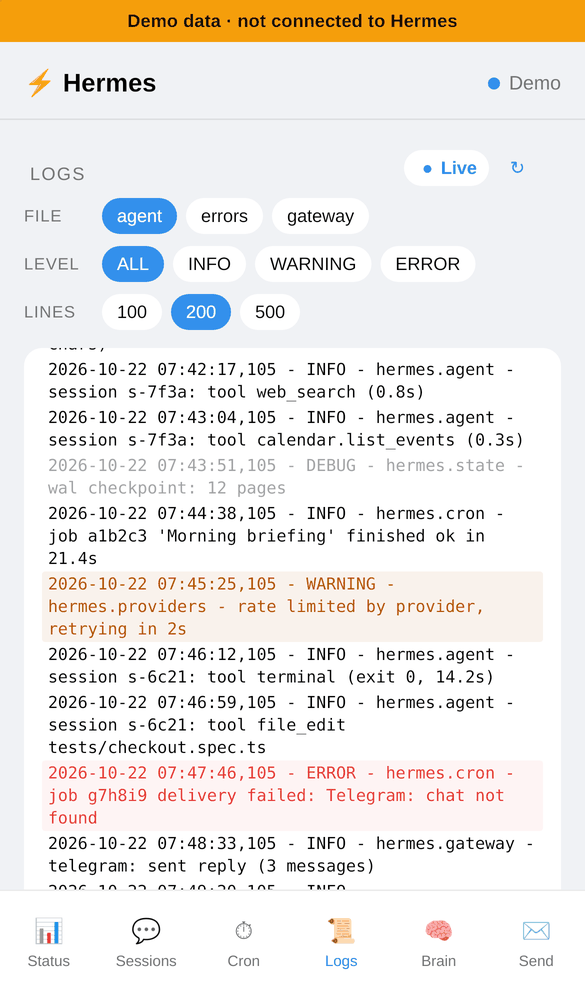
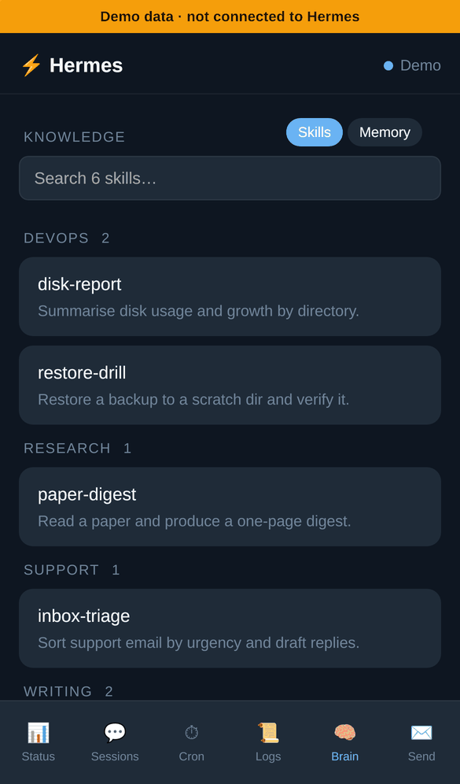

# Hermes Telegram Mini App

A phone control panel for [Hermes Agent](https://github.com/NousResearch/hermes-agent) that opens inside Telegram: check the server, browse sessions, run and edit cron jobs, read logs and skills, all from your bot's menu button.

It ships as a Hermes **dashboard plugin** (backend routes under `/api/plugins/telegram-app/`) plus a small React app served next to it. Nothing in the Hermes repository is patched or overlaid.

<table>
  <tr>
    <td></td>
    <td></td>
    <td></td>
  </tr>
  <tr>
    <td></td>
    <td></td>
    <td></td>
  </tr>
</table>

<sub>Screenshots use the built-in <a href="#demo-mode">demo mode</a> (sample data, iPhone 13 in WebKit, Telegram-style day and night palettes). More in <a href="docs/screenshots/">docs/screenshots</a>.</sub>

## Features

- **Status**: CPU, memory, disk, load and uptime; session and cron counts; token and cost totals for today, 7 days, 30 days or all time, with the most expensive sessions.
- **Push alerts** (configured from the Status tab): a Telegram DM when a cron run fails, when `errors.log` gets new errors (throttled, off by default) or when the day's estimated spend crosses a threshold.
- **Sessions**: recent sessions with source, message count, tokens and cost; open one to read its messages.
- **Cron**: create, edit, pause, resume, run now and delete agent cron jobs. Failed last runs are flagged.
- **Logs**: tail `agent.log`, `errors.log` or `gateway.log`, filtered by level, with live refresh.
- **Brain**: search installed skills and read `SKILL.md`, read the agent's `MEMORY.md` and `USER.md`.
- **Post to bot chat**: have the bot post a message into your DM. See [limitations](#known-limitations): Hermes does not act on it.
- Follows your Telegram light or dark theme, uses Telegram haptics.

## How it works

```
┌─────────────────┐  Telegram WebView
│ Telegram phone  │  ┌──────────────────────────┐
│   bot menu  →───┼──┤ React SPA (this repo)    │
└─────────────────┘  │ Telegram.WebApp.initData │
                     └────────────┬─────────────┘
                                  │ POST initData
                                  │ HTTPS via your reverse proxy,
                                  │ which forwards ONLY /api/plugins/telegram-app/*
                                  ▼
       ┌───────────────────────────────────────────────┐
       │ Hermes dashboard (FastAPI, 127.0.0.1:9119)    │
       │  /api/plugins/telegram-app/auth/verify        │
       │    ├─ HMAC-SHA256 with the bot token          │
       │    ├─ fallback: Ed25519, Telegram public key  │
       │    ├─ auth_date freshness window              │
       │    └─ user id allowlist (fails closed)        │
       │  returns the dashboard session token          │
       └───────────────────────────────────────────────┘
```

1. The SPA reads `window.Telegram.WebApp.initData` and posts it to `/auth/verify`.
2. The plugin verifies it (below) and returns the dashboard's session token.
3. The SPA sends that token as `X-Hermes-Session-Token` on every other call. The dashboard's own auth middleware checks it; the plugin does not run a second auth system.

## Security model

This panel controls an AI agent, so the login path is strict. The full review, with each finding and what changed, is in [SECURITY-REVIEW.md](SECURITY-REVIEW.md).

- **Signature.** `initData` is accepted only if its `hash` matches `HMAC-SHA256(key = HMAC-SHA256("WebAppData", bot_token), data_check_string)`, compared in constant time, exactly as in [Telegram's spec](https://core.telegram.org/bots/webapps#validating-data-received-via-the-mini-app). If that fails, the Ed25519 `signature` is checked against Telegram's published production key ([third-party validation](https://core.telegram.org/bots/webapps#validating-data-for-third-party-use)), using the bot id from your token.
- **Freshness.** `auth_date` is required and must be at most **1 hour** old by default (`TELEGRAM_INITDATA_MAX_AGE`, in seconds, clamped to 60 s to 7 days). Values more than 60 s in the future are rejected. Telegram issues new `initData` each time the Mini App opens, so the window only needs to cover one session; if the dashboard restarts after the window, reopen the app.
- **Allowlist.** Only numeric Telegram user ids in `TELEGRAM_OWNER_ID` and `TELEGRAM_ALLOWED_USERS` can log in. With neither set, every login is refused (HTTP 503) instead of letting anyone in.
- **Abuse limits.** After 10 failed attempts in 5 minutes from one client address the endpoint answers 429. Every rejection returns the same generic 403. Behind a reverse proxy all clients share the proxy's address, so the limit is effectively global; that suits a single-owner panel.
- **No secrets in logs or the client.** The bot token never leaves the server; `initData` and tokens are not logged; responses carrying the token are `Cache-Control: no-store`.
- **What the token grants.** It is the dashboard's own session token, valid until the dashboard restarts, and it authorises the whole dashboard API, not only this plugin. That is why the reverse proxy should forward **only** `/api/plugins/telegram-app/*` (see setup). The plugin's own write endpoints are narrow: cron create accepts agent jobs only (no `script`, `no_agent` or `workdir`), and the bot only posts to allowlisted users.

## Compatibility

Checked against Hermes Agent commit [`81a5543`](https://github.com/NousResearch/hermes-agent/commit/81a55437f3f31a9f12a30c53b6c5d49d420898aa) (tag `v0.22.4+canary.20261022T070155Z`, 21 Oct 2026) **by reading its source**, not by running it. Verified there:

- Dashboard plugins are discovered at `~/.hermes/plugins/<name>/dashboard/manifest.json`; the `api` file is imported and its `router` mounted at `/api/plugins/<name>/`.
- User plugins' backends load only when the plugin name is in `plugins.enabled` (Hermes security change, see setup).
- The session header is `X-Hermes-Session-Token`; `/api/*` is gated except for paths in `hermes_cli.web_server._PUBLIC_API_PATHS`.
- Data sources the endpoints use: `hermes_state.SessionDB` (`list_sessions_rich`, `session_count`, `get_messages`), `cron.jobs` (`list_jobs`, `create_job`, `update_job`, `remove_job`, `pause_job`, `resume_job`, `trigger_job`), and `~/.hermes/logs/{agent,errors,gateway}.log`.

Requirements and caveats from that check:

- The dashboard must run in its default **loopback token mode** (bound to `127.0.0.1`). If you set `dashboard.public_url` or bind publicly, Hermes switches to its cookie/OAuth gate and this plugin's token login will not work.
- `plugins.isolation: host` (plugins in a separate process) is not supported; the default `in_process` is.
- The plugin relies on two private Hermes names, `_PUBLIC_API_PATHS` and `_SESSION_TOKEN` in `hermes_cli.web_server`, because Hermes has no public API for unauthenticated plugin routes. A Hermes release that renames them will break login. `GET /api/plugins/telegram-app/health` and the dashboard log line `telegram-app: registered public paths` show whether it still works.

## Setup

You need a Hermes install with the dashboard, a bot from [@BotFather](https://t.me/BotFather), your numeric Telegram user id (for example from [@userinfobot](https://t.me/userinfobot)), a domain with HTTPS in front of the server, and Node.js 22 (or 20.19+) to build the app.

### 1. Configure Hermes

`~/.hermes/.env`:

```bash
TELEGRAM_BOT_TOKEN=123456789:AA...
TELEGRAM_OWNER_ID=1234567890
# Optional: more users, comma-separated
# TELEGRAM_ALLOWED_USERS=1234567890,9876543210
# Optional: initData freshness window in seconds (default 3600)
# TELEGRAM_INITDATA_MAX_AGE=3600
```

The plugin reads these through Hermes (`agent.secret_scope.get_secret`), never from the file itself. Values saved
through Hermes apply at once; after editing `.env` by hand, restart the dashboard.

`~/.hermes/config.yaml`, so Hermes is allowed to load the plugin's backend:

```yaml
plugins:
  enabled:
    - telegram-app
```

The Ed25519 fallback uses the `cryptography` package, which current Hermes already depends on. Without it, HMAC verification still works.

### 2. Install

```bash
git clone https://github.com/aimanmalib/hermes-telegram-miniapp.git
cd hermes-telegram-miniapp
./scripts/install.sh
```

The script builds the app into `dist/`, copies it to `WEB_ROOT` (default `/var/www/telegram-app`, set `SUDO=sudo` if needed, or `SKIP_DEPLOY=1`), symlinks `plugin/` to `~/.hermes/plugins/telegram-app`, warns if `plugins.enabled` is missing, restarts `hermes-dashboard` if that systemd unit exists, and checks `/api/dashboard/plugins` and the plugin's `/health`. Plugin routes are mounted at dashboard start, so restart the dashboard yourself if you do not use that unit.

### 3. Reverse proxy (Caddy example)

```caddy
app.example.com {
    # Forward ONLY the plugin's API. The rest of the dashboard API stays off the internet.
    handle /api/plugins/telegram-app/* {
        reverse_proxy 127.0.0.1:9119 {
            # Hermes rejects Host headers that don't match its bind address.
            header_up Host {upstream_hostport}
        }
    }
    handle /api/* {
        respond 404
    }
    handle {
        root * /var/www/telegram-app
        try_files {path} /index.html
        file_server
    }
    encode gzip
    @assets path /assets/*
    header @assets Cache-Control "public, max-age=31536000, immutable"
    header /index.html Cache-Control "no-cache"
    header Content-Security-Policy "default-src 'self'; script-src 'self' https://telegram.org; style-src 'self' 'unsafe-inline'; img-src 'self' data:; connect-src 'self'; frame-ancestors https://web.telegram.org https://*.telegram.org"
}
```

### 4. Bot menu button

```bash
TOKEN=<bot token>; USER_ID=<your id>; URL=https://app.example.com/
curl -sS -X POST "https://api.telegram.org/bot${TOKEN}/setChatMenuButton" \
  -H "Content-Type: application/json" \
  -d "{\"chat_id\": ${USER_ID}, \"menu_button\": {\"type\": \"web_app\", \"text\": \"Hermes\", \"web_app\": {\"url\": \"${URL}\"}}}"
```

### 5. Check it

Tap the menu button in your chat with the bot. The Status tab should show live numbers and the header your first name. The dashboard also gets a small **Telegram Mini App** tab showing whether the backend is up.

## Demo mode

Demo mode renders every tab with built-in sample data and makes no API calls, so the UI can be shown without a Hermes server. A yellow **Demo data · not connected to Hermes** banner stays at the top.

```bash
cd web
npm ci
npm run build:demo        # writes ../dist-demo/ (never ../dist/)
python3 -m http.server 3392 --bind 127.0.0.1 --directory ../dist-demo
# open http://127.0.0.1:3392/?theme=light  (or ?theme=dark)
```

On the Vite dev server, `npm run dev` and open `/?demo=1`. A normal `npm run build` compiles demo mode out completely; `npm run check:no-demo` (run in CI) fails if any demo code reaches `dist/`. The README screenshots are made with `scripts/screenshots.py` from the demo build.

## Development

```bash
# Plugin (Python 3.11+)
pip install -r requirements-dev.txt
python -m pytest

# Web app (Node 22)
cd web && npm ci
npm run typecheck && npm test && npm run build
npm run dev   # Vite on :5173, proxies /api to 127.0.0.1:9119
```

Outside Telegram the dev server can use a real dashboard: set `localStorage.devSessionToken` to the value of `window.__HERMES_SESSION_TOKEN__` from the dashboard page. Production builds ignore it.

The Python tests include known-answer vectors for the HMAC check, computed independently with `openssl`, plus tampering, staleness, allowlist, malformed-input, Ed25519 and HTTP-level tests. CI runs them on Python 3.11 and 3.12, and typechecks, tests and builds the web app on Node 22.

## API

All under `/api/plugins/telegram-app/`.

| Method | Path | Auth | Purpose |
|---|---|---|---|
| GET | `/health` | public | Liveness and plugin version |
| POST | `/auth/verify` | initData | Verify initData, return the session token |
| GET | `/status` | session | System gauges, session and cron counts |
| GET | `/usage?window=today\|week\|month\|all` | session | Token and cost totals, top sessions |
| GET | `/sessions?limit=N` | session | Recent sessions |
| GET | `/sessions/{id}/messages` | session | Messages of one session (trimmed for phones) |
| GET, POST | `/cron` | session | List jobs, create an agent job |
| PATCH, DELETE | `/cron/{id}` | session | Edit or delete a job |
| POST | `/cron/{id}/pause\|resume\|trigger` | session | Pause, resume, run now |
| GET | `/logs?file=&lines=&level=` | session | Tail a Hermes log |
| GET | `/skills`, `/skills/{id}` | session | Skill list and `SKILL.md` text |
| GET | `/memory` | session | `MEMORY.md` and `USER.md` |
| GET, PATCH | `/alerts` | session | Alert settings and watcher state |
| POST | `/alerts/test` | session | Send a test alert |
| POST | `/command` | session | Bot posts text to an allowlisted user's DM |

## Troubleshooting

- **"Open this app from the Telegram bot menu button"**: the page was opened outside Telegram, so there is no `initData`.
- **`auth/verify 503: Mini App login is not configured`**: `TELEGRAM_BOT_TOKEN` or the allowlist (`TELEGRAM_OWNER_ID` / `TELEGRAM_ALLOWED_USERS`) is missing.
- **`auth/verify 403`**: wrong bot token, a user id not on the allowlist, or `initData` older than the freshness window. Reopen the Mini App; the dashboard log says which check failed (`initData rejected (stale)` and similar).
- **`auth/verify 429`**: too many failed attempts; wait for the `Retry-After` seconds.
- **`401` on every call / 404 on `/api/plugins/telegram-app/...`**: the plugin is not in `plugins.enabled`, or the dashboard was not restarted after installing. Check `curl http://127.0.0.1:9119/api/plugins/telegram-app/health`.
- **`400 Invalid Host header`**: the proxy forwards your public hostname; keep `header_up Host {upstream_hostport}`.
- **Login works locally but not through the proxy after enabling `dashboard.public_url`**: that setting turns on Hermes' cookie gate, which this plugin does not support.

## Known limitations

- **Post to bot chat does not reach Hermes.** The message is sent by the bot, and Telegram never delivers a bot's own messages back to it, so the Hermes gateway does not see it. To give Hermes a task from the panel, create a cron job and use **Run now**.
- Login depends on private Hermes internals (see [compatibility](#compatibility)).
- One dashboard process, one profile: multi-profile hosting and `plugins.isolation: host` are untested.

## How this was built

hermes-telegram-miniapp was built with AI coding assistance (Claude Code) under the direction of its author, Muhammad Aiman.

The evidence that it works is meant to be checkable:

- The test suite, run with `python -m pytest` and `cd web && npm test`.
- CI on Python 3.11 and 3.12, and Node 22 for every pull request.
- 2 tagged releases, with notes in [CHANGELOG.md](CHANGELOG.md).

## License

MIT, see [LICENSE](LICENSE). Security issues: see [SECURITY.md](SECURITY.md).

Inspired by [clawvader-tech/hermes-telegram-miniapp](https://github.com/clawvader-tech/hermes-telegram-miniapp), rebuilt as a plugin instead of an overlay on the Hermes web server.

---

Built by [Sasa Teguh](https://sasateguh.com) · Malaysia
